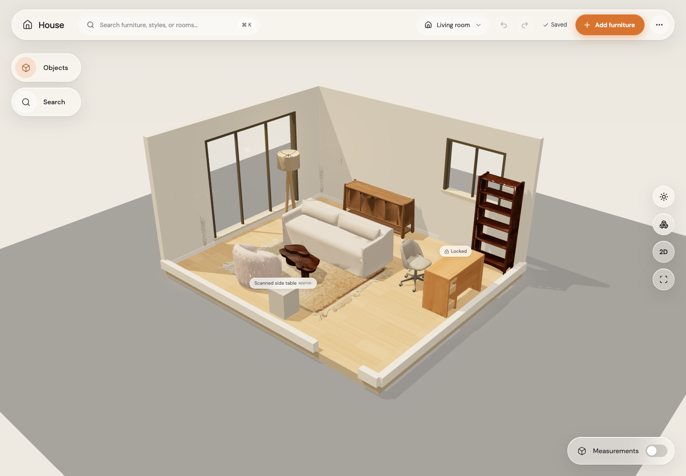
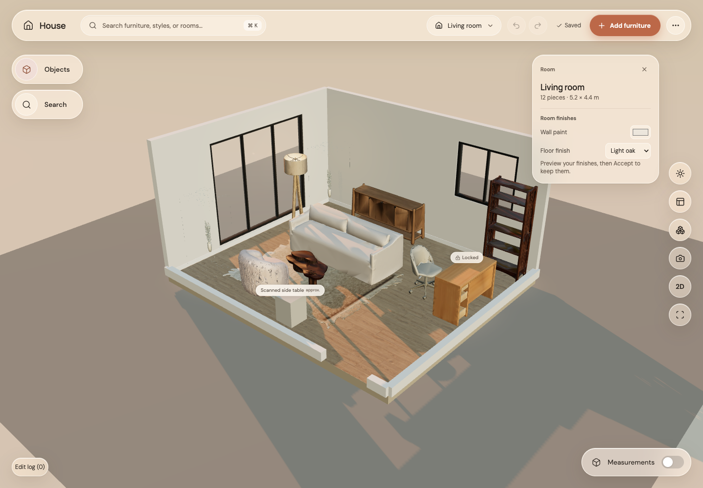
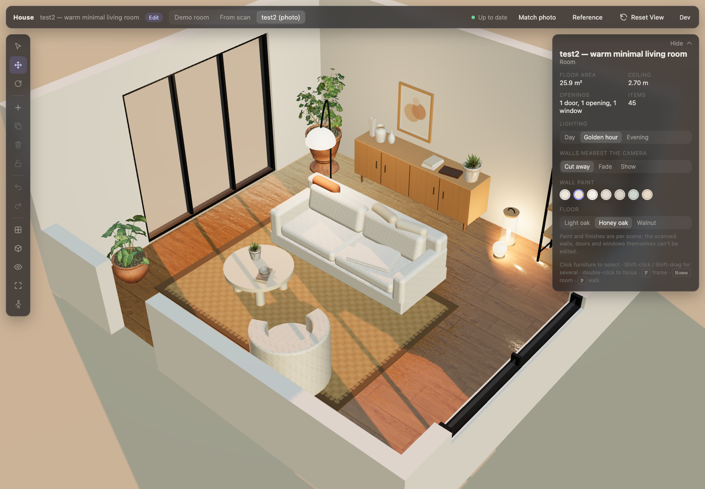
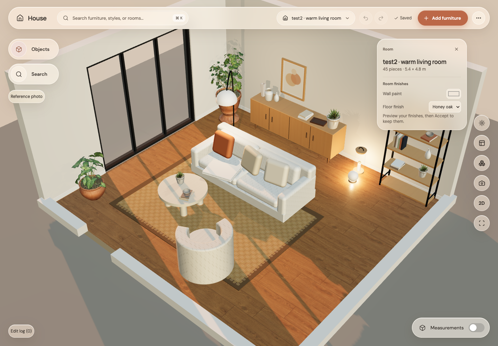
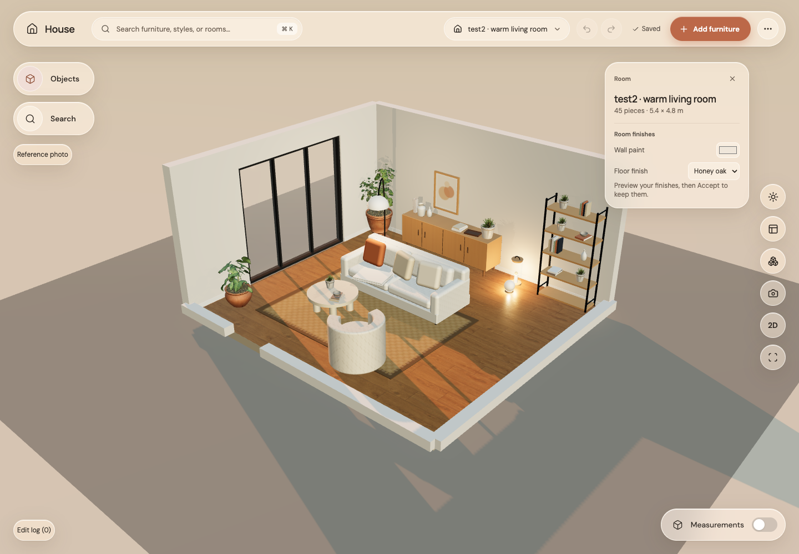
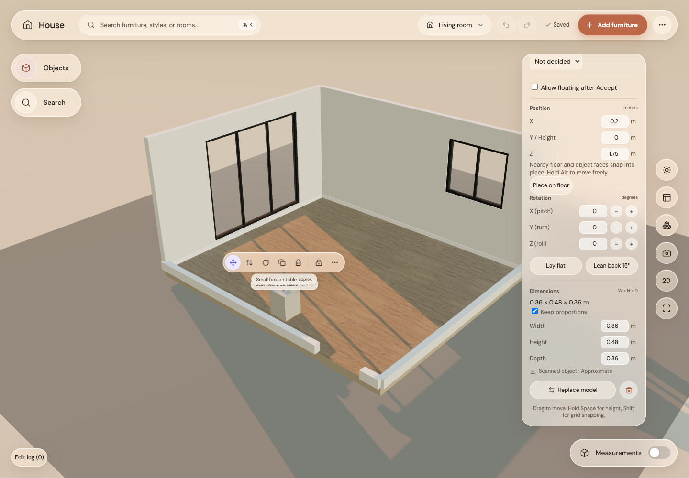
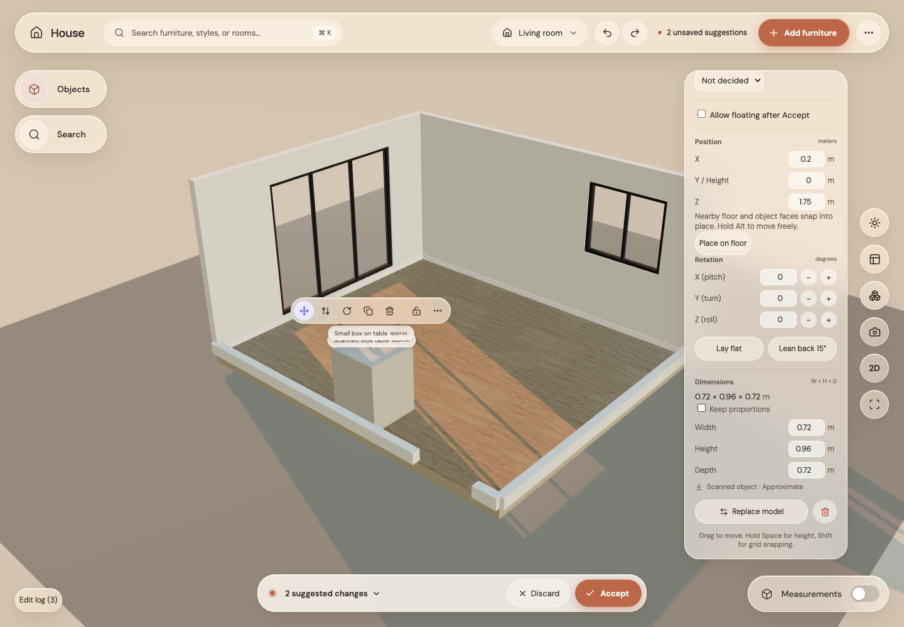
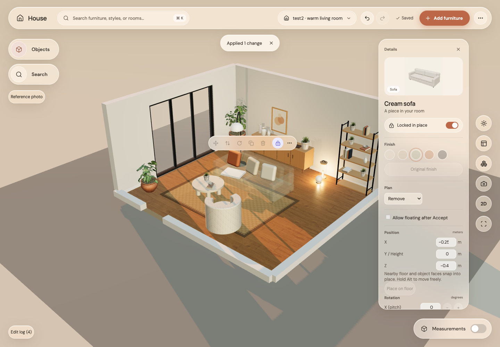
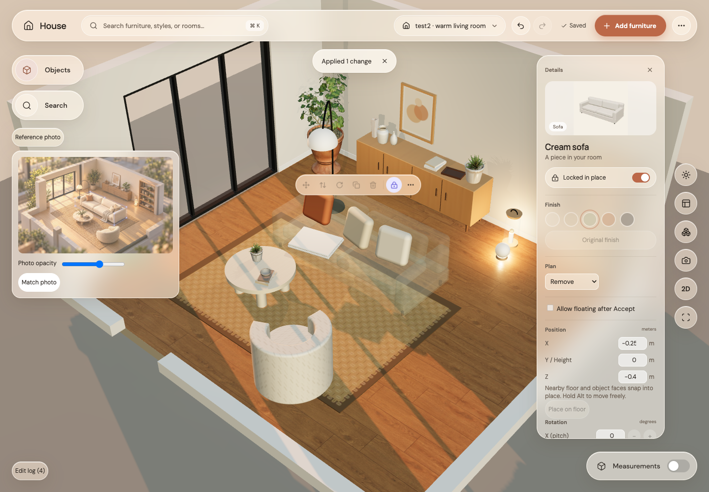
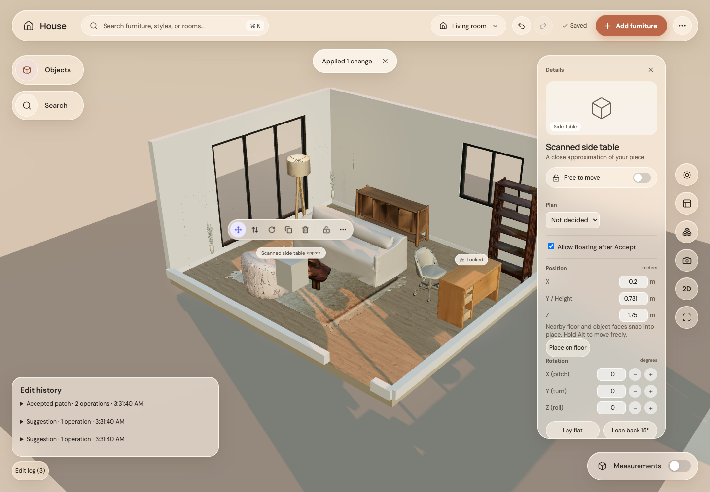

# House 3D sandbox merge complete

All planned steps are implemented in `/Users/jeffreyg/Projects/digital-home-codex-base`, branch `feature/3d-sandbox-codex-base`. Commits remain local; nothing was pushed. The app is available at http://127.0.0.1:5185.

## What changed

Codex’s free suggestion phase, exact face snapping, compound collisions and Accept resolver remain the editing foundation. The merge adds the richer catalog and rooms, warm lighting/materials/glass, camera transitions and walk mode, full rotation, practical lights, duplicate, keyboard nudges, editable positions, multi-select, groups, wall/ceiling mounting, resize, Float, finishes, planning, ranked replacement, library dragging, reference photos, development actions, patch saving and an expandable typed edit log.

Resize leaves seated items their original size. Float is an explicit support exception; uncheck it to restore normal settling. Remove is a planning ghost, not deletion. Regular movement has no automatic decor hop or rotation about a multi-selection centre. Library dragging uses captured pointer movement and occupied top faces; clicks retain the original placement search.

## Verification

Formatting, TypeScript, ESLint, production build, **237 unit tests** and **all 24 GPU Chrome browser tests** passed on the finished implementation. The browser suite used `HOUSE_BROWSER_GPU=1 HOUSE_E2E_PORT=5185` and the system Google Chrome executable and completed in 1.9 minutes. It covers real pointer gestures, stack snapping/carrying, chair-under-desk collision, couch containment, undo, save/reload, full rotation, groups, mounting, resize, Float, finishes, locked planning, reference camera, typed logs, simulated failed saves/retry, conflict state, and library drop.

Patch tests verify reconstruction, stacked move/resize, revision CAS, repeated-key rejection and idempotent retry after an applied save loses its acknowledgement. The local adapter writes the scene and its last 80 retry receipts atomically. This is local persistence; no remote backend or authentication was added.

The final comparison loaded Codex on 5182, Jordan on 5181 and the merge on 5185 in GPU Chrome without page errors. A fresh FPS comparison across all three versions and subjective human feel testing were not performed. Earlier step 11 measured 58.9 average rendered FPS on an M4 test2 drag; this is not a guarantee for every final workload or device. Geometry remains an approximation, not exact mesh physics or a mass simulation.

## Before and after: original Codex and merged living room

Original Codex:

Merged:

## Comparison with Jordan

Jordan’s test2:

Merged test2 using Match photo for a comparable closer view:

| Version         | Strength                                                                                                                                                   | Tradeoff                                                                                                                      |
| --------------- | ---------------------------------------------------------------------------------------------------------------------------------------------------------- | ----------------------------------------------------------------------------------------------------------------------------- |
| Original Codex  | Compact controls and the familiar direct editing flow                                                                                                      | Smaller catalog, simpler room look and fewer editing tools                                                                    |
| Jordan          | Strong warm-room reference and close photo framing                                                                                                         | Denser dark panels and taller cut-away walls obscure more of the room; its interaction/physics were not the chosen foundation |
| Completed merge | Codex’s editing foundation with the richer room presentation, camera, catalog and extra controls; low cut-away walls and warm glass keep the scene visible | More inspector sections and a larger application bundle                                                                       |

**Recommendation: use the completed merge.** It retains the editing rules the user preferred and now includes the requested breadth. Jordan remains a useful visual reference. The original Codex is still the leanest interface. Camera framing affects perceived visual quality: the merge defaults to a wider editing view, with Match photo available for the closer composition.

Merged default editing view of test2:

## Remaining features in plain words

Resize before:

Resize after: the support doubled in size while the small box stayed its original size and followed the top.

Finishes and planning: Sage is selected, and the locked sofa can still be marked Remove. Its ghost remains physically present for planning.

Reference overlay and Match photo:

A saved floating suggestion and its typed edit history:

## Decisions left to the user

No implementation decision is blocking. The final visual/feel preference is yours; the recommendation above is based on the captured views and automated interaction checks. Nothing was merged into another branch or pushed.
