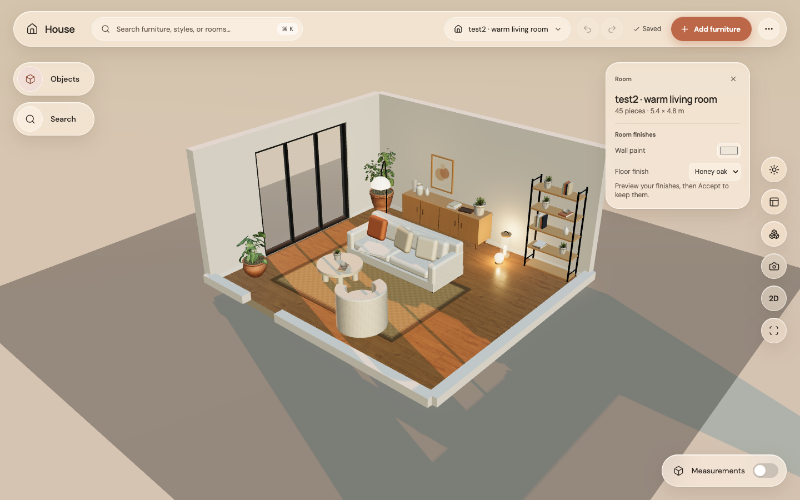
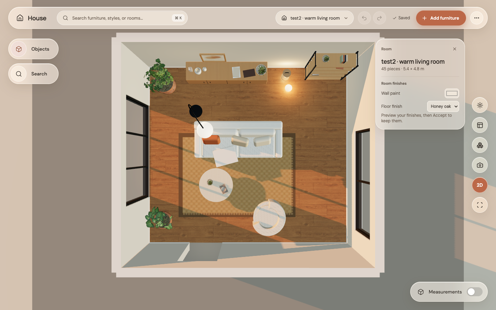
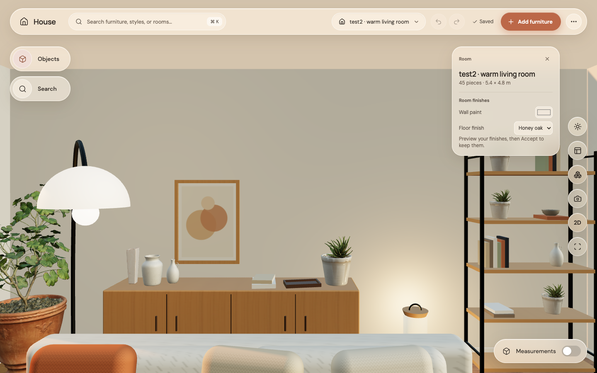
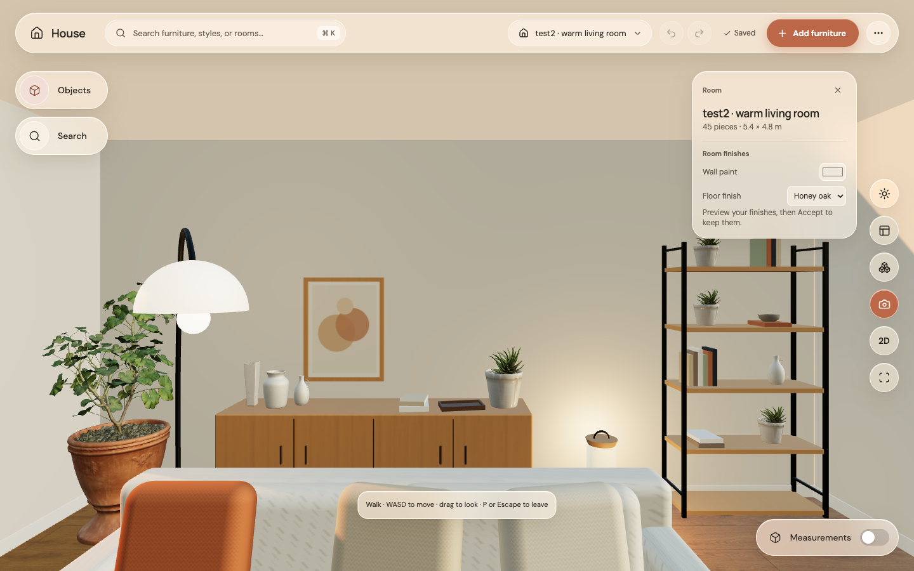

# Step 10: camera views and walking

The camera now eases between views and zooms toward the cursor. Open the camera button for Isometric, Top, Eye level, Frame selection, Frame room, or Walk through room. P enters/leaves walk mode; WASD moves and Escape leaves. The existing 2D button now opens the actual top view.

| Before | Updated isometric |
|---|---|
|  |  |

| Top | Eye level |
|---|---|
|  |  |

The living room keeps the exact Codex starting pose. Other rooms centre their own framing. Framing preserves the viewing direction, and furniture drags stop camera movement first. A GPU browser test covers smooth walk entry, movement without edits, framing, and a real furniture drag that leaves the camera still. No page errors occurred during the GPU visual review.
