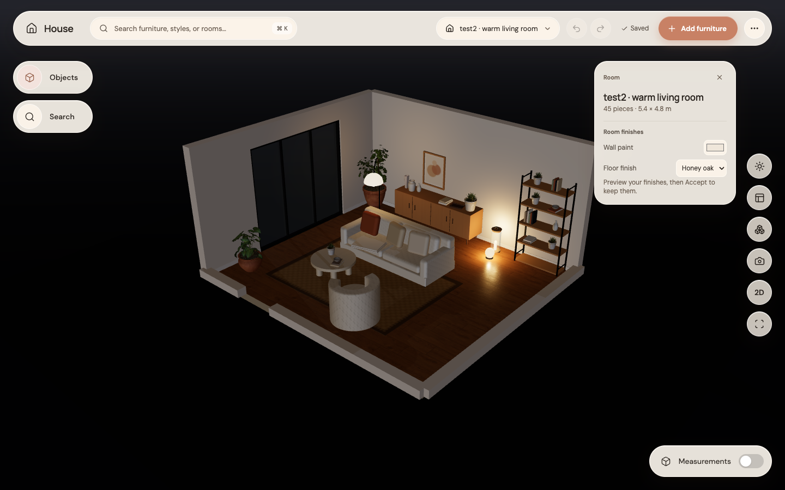
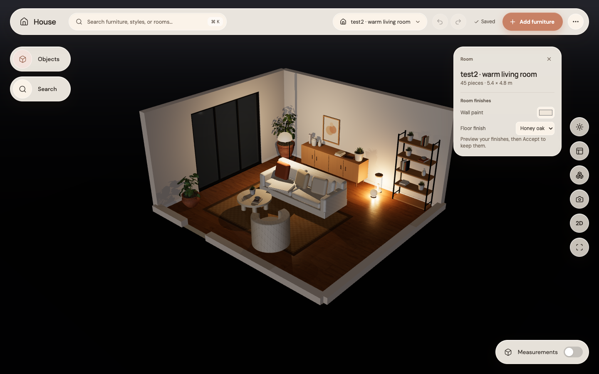
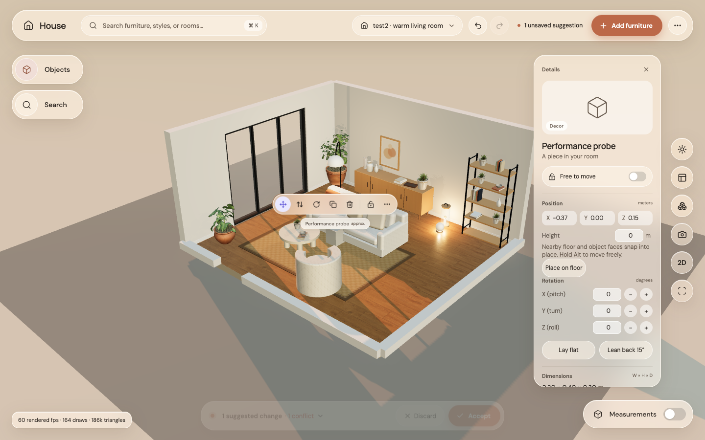

# Step 11: lamps and rendering when needed

Select a lamp to switch it on or off in the inspector. The change previews as a suggestion and survives Accept, undo and reload. Bulbs and shades glow on their own instance; switching one does not alter other instances of the same model.

| Before, Evening | After, Evening |
|---|---|
|  |  |

Rendering now stops when the room settles, and resumes for camera movement, gestures, edits and asset loading. Animations warm up their first frame after an idle pause so they do not jump. Lighting is capped at eight active practical lights, with one practical shadow plus the sun’s shadow.

Open `?perf` for rendered frame rate and the finished scene pass’s draw/triangle counts. An M4 Metal sample in the 45-piece test2 room plus a probe box averaged **58.9 rendered FPS** during a real pointer drag (rolling reading **59.9 FPS**), with **164 scene draws / 186,457 triangles**. The idle check rendered **zero frames in 400 ms**.

All checks passed: 211 unit tests and 14 GPU browser tests, format, typecheck, lint and build. The browser tests include idle stopping/resumption, lamp persistence, smooth camera entry, real furniture manipulation and the existing collision/snapping/save flows.
