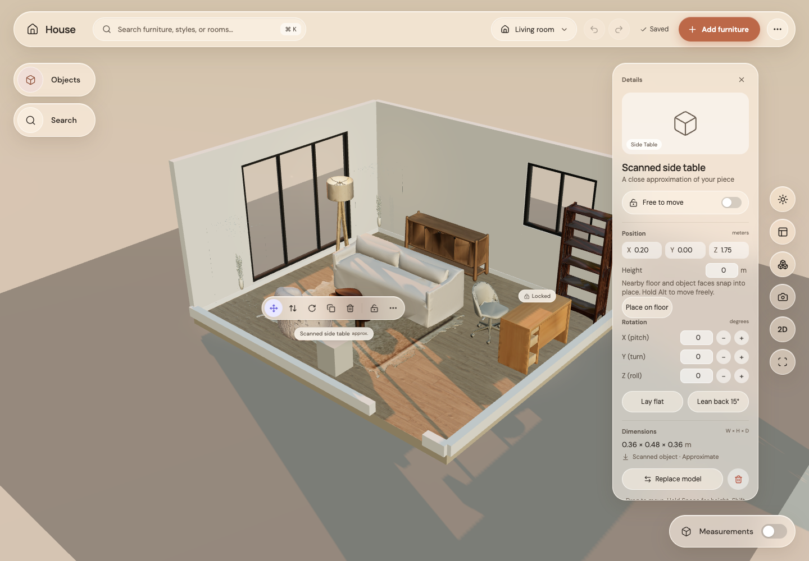
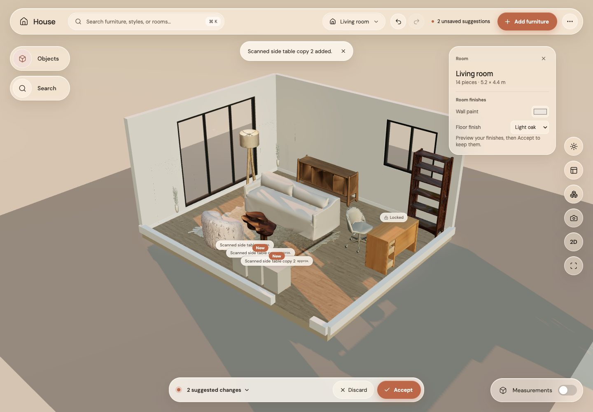

# Step 12: duplicate pieces

Use Duplicate in the object toolbar or Ctrl/Cmd+D. A copy keeps the model, dimensions, full rotation, scale, finishes and light state, gets a new identity, and appears in a nearby valid spot. It is a suggestion until Accept. Locked pieces and active gestures are protected.

| Before | After toolbar and keyboard copies |
|---|---|
|  |  |

Undo/redo and save/reload are covered in the GPU browser test. All checks passed: 213 unit tests and 15 GPU browser tests, format, typecheck, lint and build. Screenshots wait for asset loading so the review shows the furnished room.
