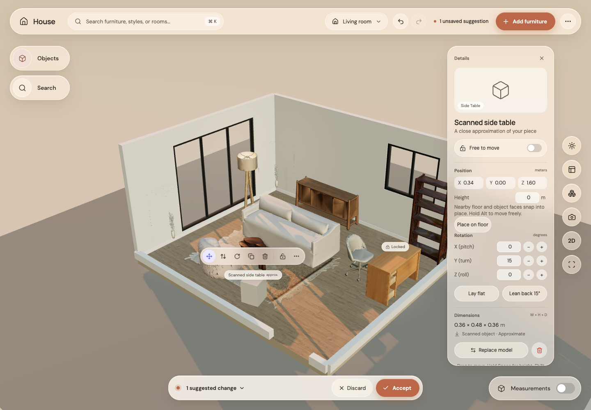

# Step 13: keyboard editing

Arrow keys now move the selected piece relative to the camera: 2 cm, or 20 cm with Shift. Q/E turn on the absolute 15° grid while preserving pitch and roll. F frames the selection, Home frames the room, and P enters walk mode. Typing in fields and active drags are protected. Changes remain suggestions until Accept; each nudge can be undone.

Before keyboard edits:

After two nudges, a turn, and Home framing:

Verified with 216 unit tests and 16 GPU Chrome browser tests, plus formatting, type checking, lint and production build. The browser regression sends real key events through the app.
