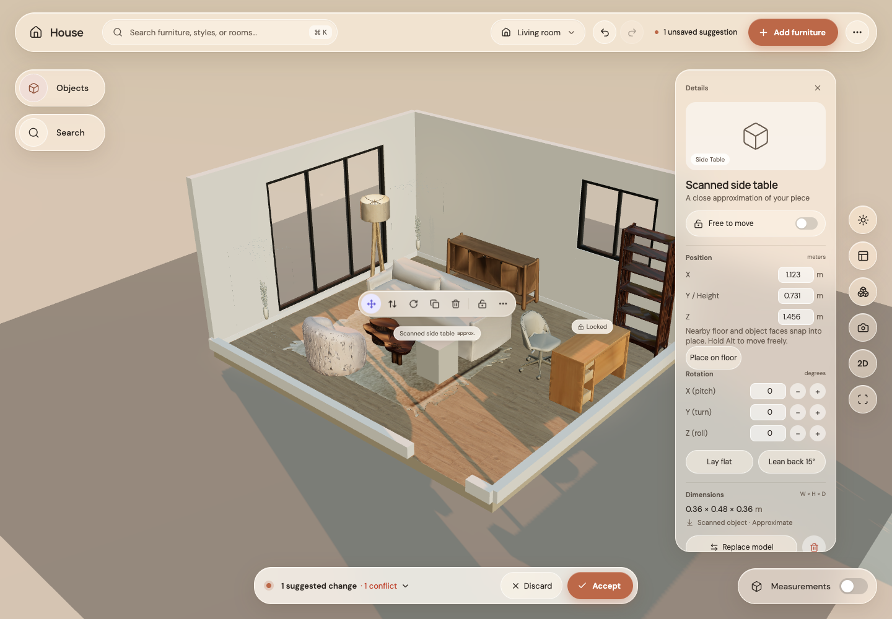

# Step 14: exact positions

Before: X/Y/Z were readouts and only Height could be edited.

After: all three coordinates are editable in metres. Enter or leaving the field creates one suggestion. Typed values stay exact, without magnetic snapping; Accept still settles and resolves them. Locked pieces and active drags disable the fields. Height-only edits now correctly appear as movement.

All checks passed: 218 unit tests, 17 GPU browser tests, formatting, type checking, lint and production build. Browser regressions verify exact values and individual undo, plus the existing Space-to-lift drag.
