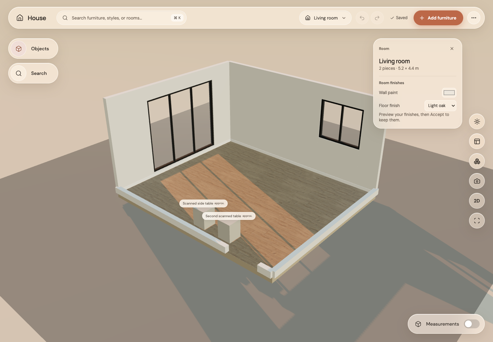
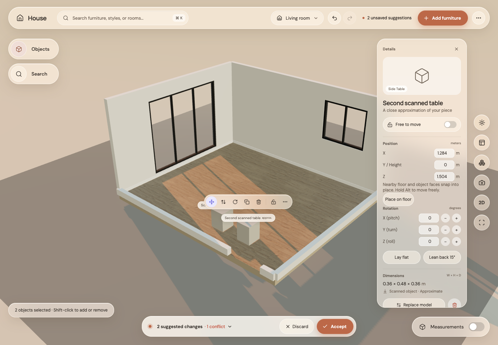

# Step 15: select and move several pieces

Before: selecting another piece replaced the selection.

After: Shift-click adds/removes pieces. Shift-drag on the background draws an additive selection rectangle. A count confirms the selection; drag or arrow-nudge moves all selected pieces as one undoable suggestion. Supported children move once. Locked members protect the whole gesture. F frames the whole selection. Rotation still acts on the primary piece, with no rotation about the selection centre.

All checks passed: 221 unit tests, 18 GPU browser tests, formatting, type checking, lint and production build. Real mouse tests cover Shift-click, multi-piece dragging and marquee selection. Existing GPU-free tests confirm Shift-drag keeps grid snapping and models do not rerender per pointer move.
