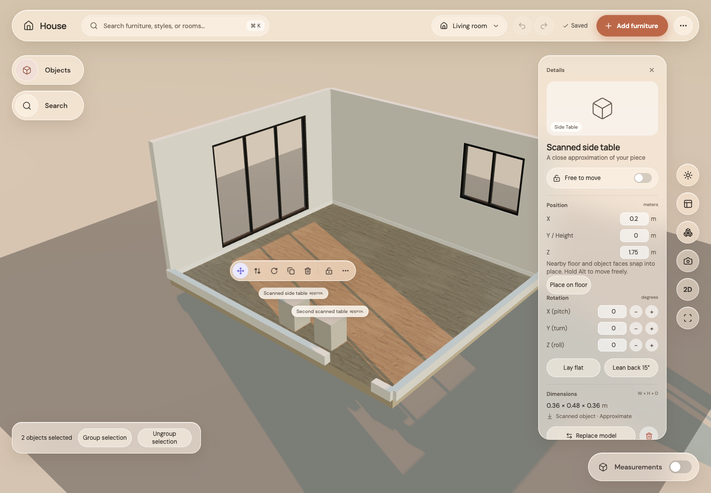

# Step 16: saved groups

Before: a multi-selection was temporary.

After: Group selection or Ctrl/Cmd+G saves a group as a suggestion. Accept keeps it across reloads. Clicking a member selects its group; Alt-click selects just that member. Ungroup selection or Shift+Ctrl/Cmd+G breaks the group, with undo. Locked pieces remain protected. Grouping does not change collision or support rules, and duplicating one member makes an independent copy.

All checks passed: 223 unit tests, 19 GPU browser tests, formatting, type checking, lint and production build. Browser regression covers grouping, Accept/save/reload, normal group selection, Alt-member selection, ungroup and undo. A normal click after Alt-member selection restores the group.
