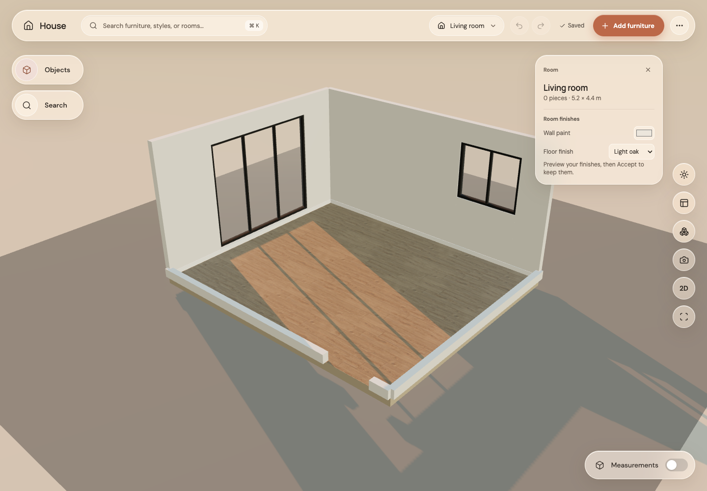
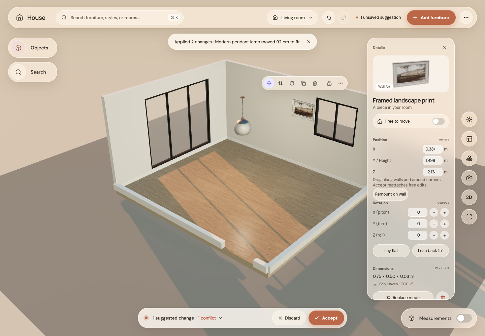

# Step 17: walls and ceiling

Before: artwork could be labelled wall-supported without touching a wall, and pendants were treated as floor pieces.

After: library artwork mounts on a solid wall area; dragging follows the wall and turns around corners. Pendants attach their top to the ceiling. Free height edits stay where suggested until Accept, which remounts them. Collision checks include mounted pieces, and art cannot cover a door/window opening. Cut-away wall visibility still applies. Imported transparent glass is made clear per instance so it does not hide a picture or cast an opaque shadow over it.

All checks passed: 229 unit tests, 20 GPU browser tests, formatting, type checking, lint and production build. GPU-free corner test verifies live orientation, continued motion on the new face, one release step, and no per-pointer model renders. Real-browser coverage adds art/pendant, free height, Accept, wall drag and reload. Every room fixture remains valid. No ceiling mesh is added to block the dollhouse view.
