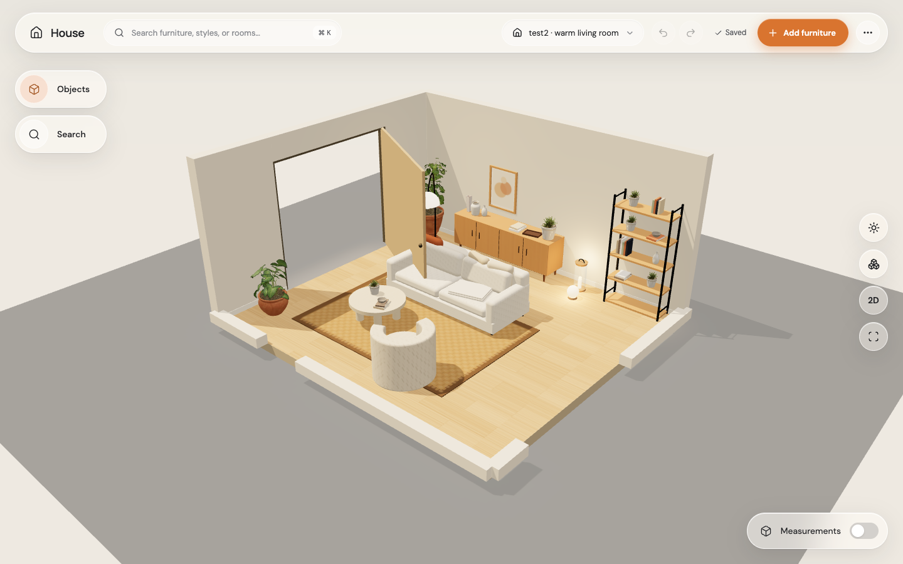
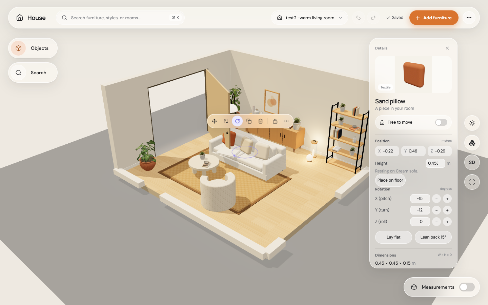

# Step 5: turn pieces in every direction

You can now tip, turn, or roll any piece using X/Y/Z fields, 15° buttons, Lay flat, and Lean back 15°. The swivel circle stays horizontal and preserves the tip. Attached pieces keep their relative poses.

Before Accept, pieces stay exactly where you put them. Accept places the lowest occupied part onto the nearest support, then applies collision and stability rules. The test2 pillows lean in front of the back cushion; the throw rests on the seat. All 45 pieces validate without a soft-item collision exemption.

| Before | After |
|---|---|
|  |  |

GPU Chrome used the Apple M4 Metal renderer. Real mouse drags on the original Codex (5182) and this merge (5185) produced the same movement and one suggestion per drag. This is a functional comparison, not a measured 60 FPS guarantee.

Stability is approximate: collider volume stands in for mass, and the existing 2 cm settling band accounts for uneven surfaces. Authored upright floor assets are assumed stable because their weighted bases and material densities are unavailable. Collision tolerance stays 0.1 mm. Supports are the floor and horizontal furniture faces, with nearby side contacts contributing when leaning.
