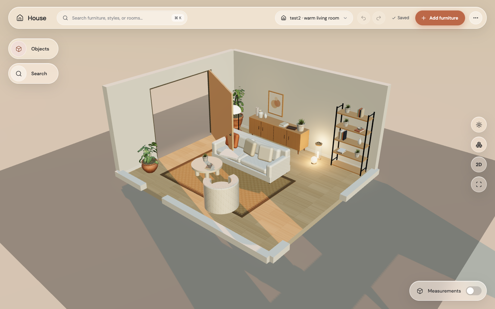
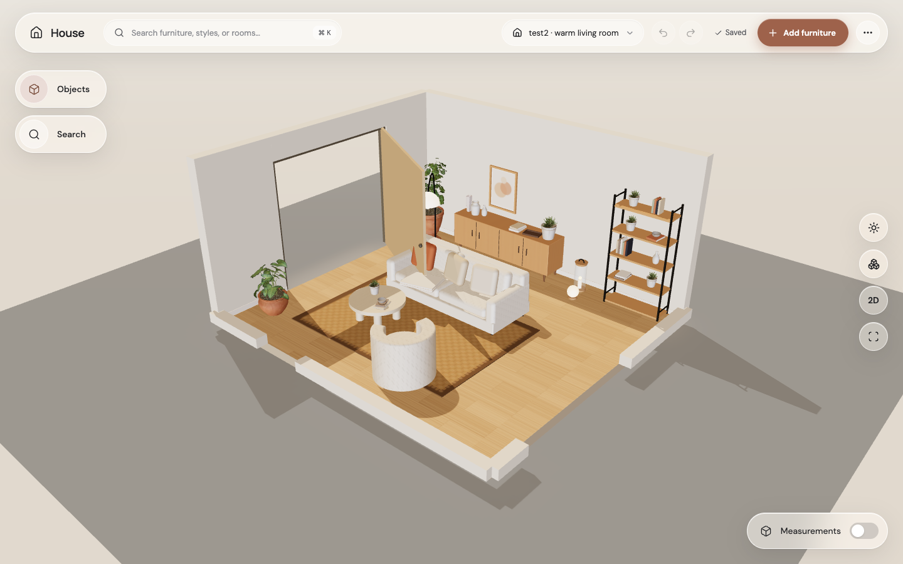
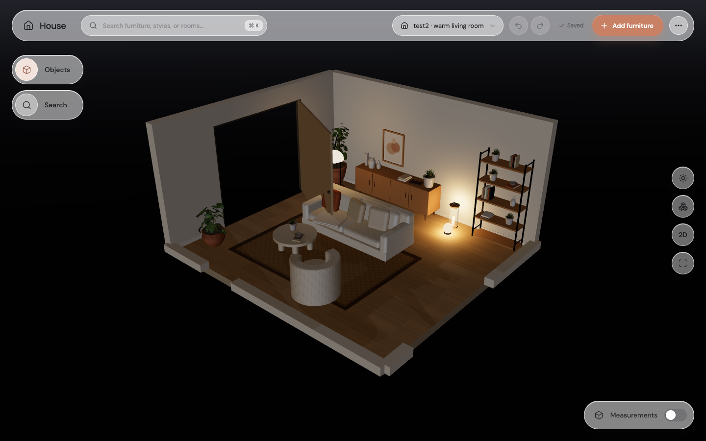

# Step 7: daylight, golden hour, and evening

The room now uses local environment lighting and a sun aimed through its main glazed opening. Shadows fit the room even when it is away from the world origin. The lighting button keeps its familiar first change from Golden hour to Daylight, then adds Evening. The accent and backdrop follow the chosen preset.

| Before | Golden hour |
|---|---|
|  |  |

| Daylight | Evening |
|---|---|
|  |  |

GPU Chrome images use the Apple M4 Metal renderer. Environment files are copied from Jordan’s branch with its CC0 source credits. No CDN requests are needed. One sun casts shadows; per-lamp controls and the final light-glass tint arrive in later steps.
