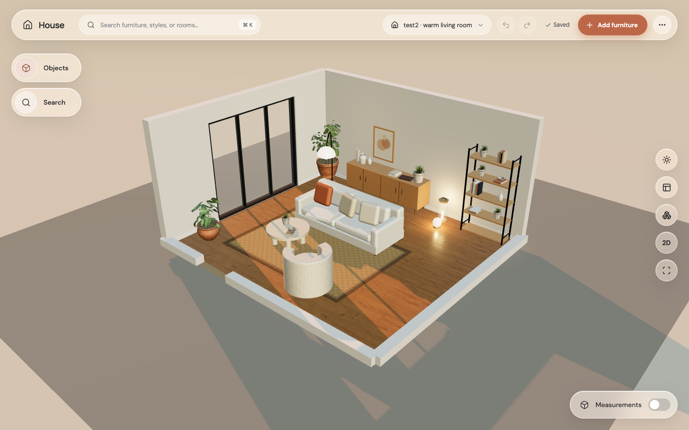
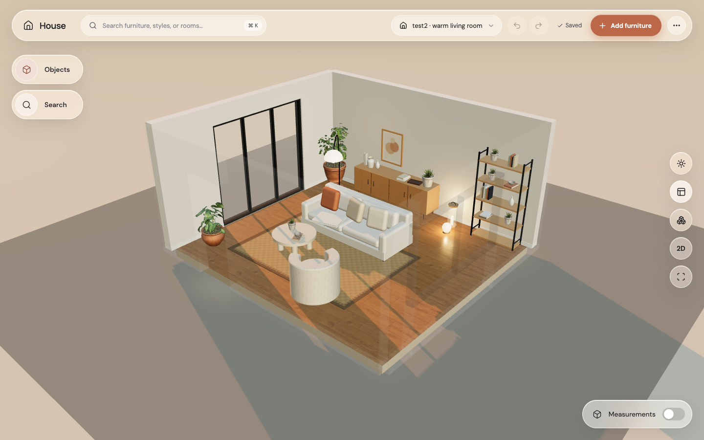
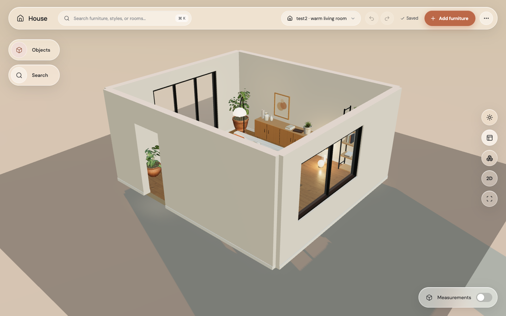
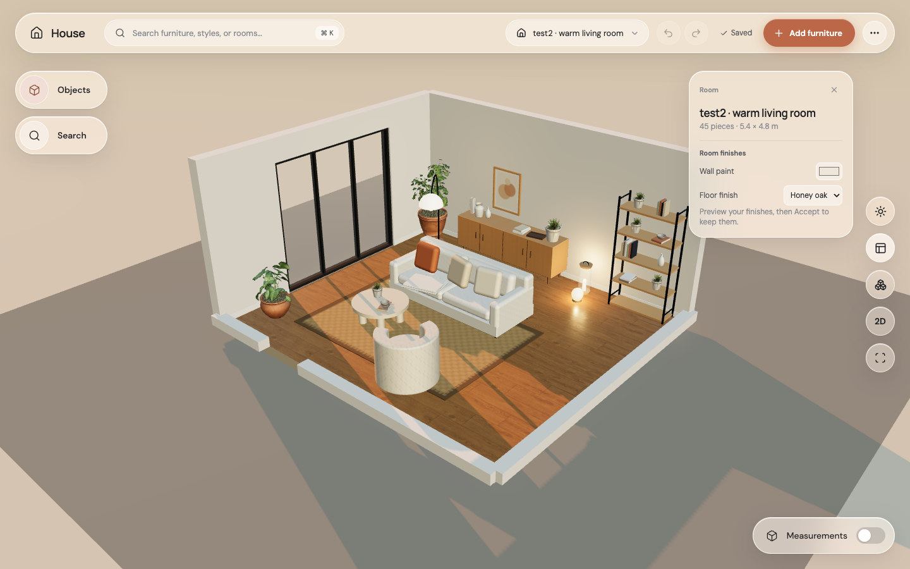

# Step 8: room shell and finishes

Glazed doors now have glass and slim frames; open doorways stay open. The oversized door panel crossing the sofa is gone. Floors use local PBR textures, and each scene’s paint and floor choice is respected.

| Before | After |
|---|---|
|  |  |

| Fade walls | Show walls |
|---|---|
|  |  |

The wall button cycles Cut away, Fade, and Show. Codex’s low cut-away height is retained so furniture stays visible and easy to edit. Wall-mounted pieces hide with their wall and cannot intercept clicks while hidden. Paint and floor choices are suggestions: preview, undo, Accept, save, and reload use the same editor path as furniture edits.

GPU Chrome used Apple M4 Metal, with no page errors during this visual review. Local floor textures retain Jordan’s CC0 credits. The opt-in `HOUSE_BROWSER_GPU=1` runs Playwright on the same verified Metal path; the default software path remains available.
