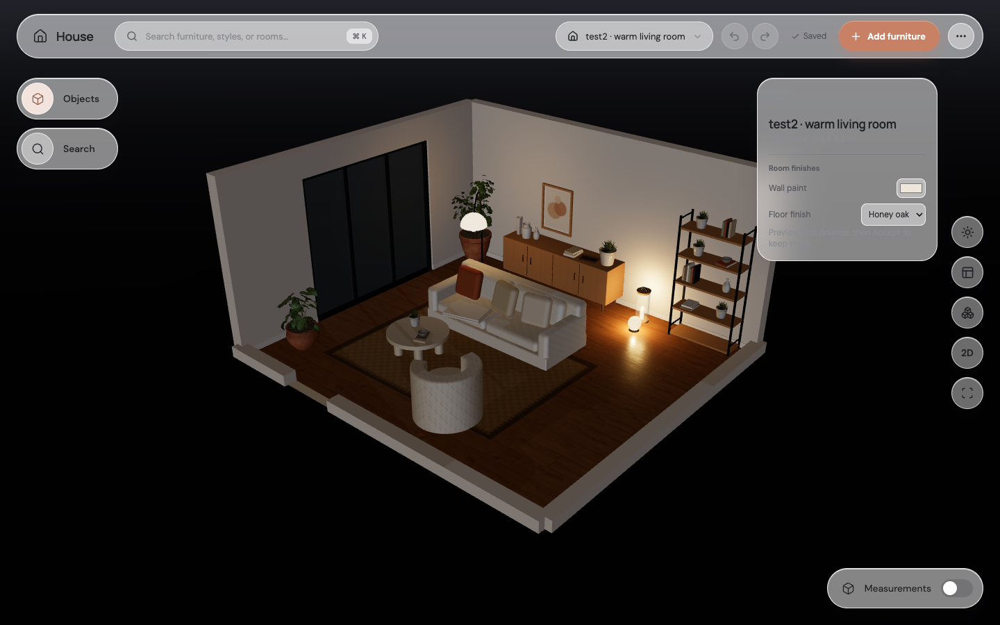
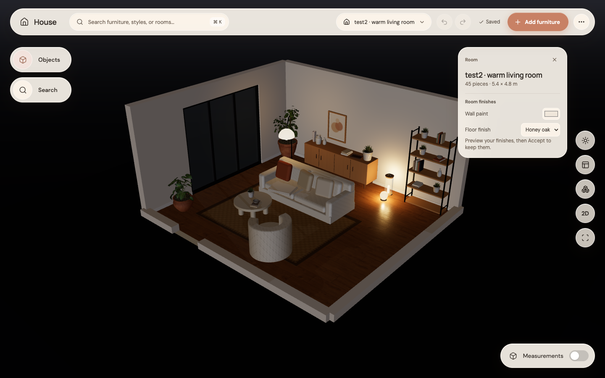
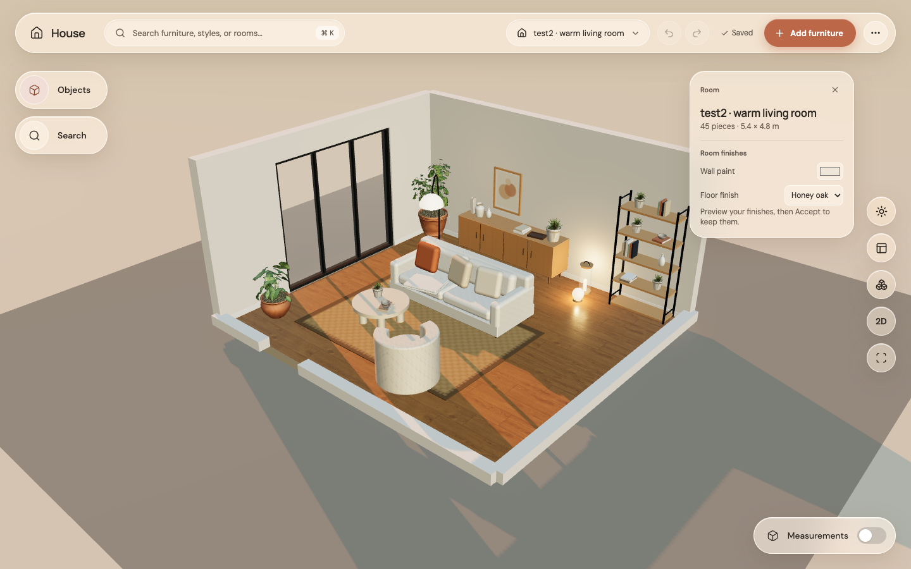

# Step 9: warm, readable glass

Panels now have a cream tint, warm ink and shadows, and a stronger fill in Evening. The layout and controls stay where they were. Secondary room text is darker and readable across the three lighting presets.

| Before, Evening | After, Evening |
|---|---|
|  |  |

A new browser regression checks secondary room text against the composited panel/backdrop in Daylight, Golden hour and Evening. The original Golden hour check failed at 2.64:1; the updated text clears 4.5:1 in all three. This is a focused text-contrast check, not a claim that the entire interface has had an accessibility audit. GPU images use Apple M4 Metal.
